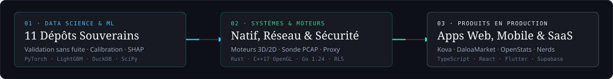

<div align="center">

<picture>
  <source media="(prefers-color-scheme: dark)" srcset="./assets/hero-dark.svg" />
  <source media="(prefers-color-scheme: light)" srcset="./assets/hero-light.svg" />
  
</picture>

<br/><br/>

<a href="https://elmas.solutions">
  
</a>

<p align="center">
  <a href="https://elmas.solutions"></a>&nbsp;
  <a href="https://www.linkedin.com/in/elmas-dev"></a>&nbsp;
  <a href="mailto:elmastresoroulobo@gmail.com"></a>&nbsp;
  <a href="https://play.google.com/store/apps/details?id=com.daloamarket.app"></a>
</p>

<p align="center">
  &nbsp;
  <a href="https://github.com/elm-as?tab=followers"></a>&nbsp;
  
</p>

<br/>

<picture>
  <source media="(prefers-color-scheme: dark)" srcset="./assets/pipeline-dark.svg" />
  <source media="(prefers-color-scheme: light)" srcset="./assets/pipeline-light.svg" />
  
</picture>

</div>

---

## Profil & Charte d'Ingénierie

```python
from dataclasses import dataclass

@dataclass(frozen=True)
class ElmasTresorOulobo:
    studio: str       = "ElmasCore - From Data to Systems"
    role: str         = "Architecte Systèmes, Data Scientist & Software Engineer"
    location: str     = "Abidjan / Daloa, Côte d'Ivoire (Open to Remote)"
    degrees: tuple    = (
        "Licence en Modélisation Statistique - UJLoG (Daloa)",
        "Master Data Science & IA - Université Rennes 2",
    )
    flagships: tuple  = ("DataScience Hub (15 dépôts)", "Kova", "OpenStats", "Daloa Market", "LSFB Live", "Kiln")
    core_stack: tuple = ("Python", "TypeScript", "Rust", "C++17", "Go", "Flutter", "PostgreSQL RLS", "DuckDB")
    email: str        = "elmastresoroulobo@gmail.com"
    charter: tuple    = (
        "Données propres et validation sans fuite avant toute modélisation",
        "Architecture par domaine métier, fonctions pures et fichiers <= 350 lignes",
        "Sécurité appliquée en base (PostgreSQL RLS) et zéro secret exposé côté client",
    )
```

---

## Projets Phares

<div align="center">

<table>
<tr>
<td width="50%">
  <a href="https://github.com/elm-as/DataScience">
    
  </a>
</td>
<td width="50%">
  <a href="https://github.com/elm-as/Kova">
    
  </a>
</td>
</tr>
<tr>
<td width="50%">
  <a href="https://github.com/elm-as/OpenStats">
    
  </a>
</td>
<td width="50%">
  <a href="https://github.com/elm-as/DaloaMarket-App">
    
  </a>
</td>
</tr>
<tr>
<td width="50%">
  <a href="https://github.com/elm-as/lsfb-live">
    
  </a>
</td>
<td width="50%">
  <a href="https://github.com/elm-as/Kiln">
    
  </a>
</td>
</tr>
<tr>
<td width="50%">
  <a href="https://github.com/elm-as/NetSentinel">
    
  </a>
</td>
<td width="50%">
  <a href="https://github.com/elm-as/ElmasCore">
    
  </a>
</td>
</tr>
</table>

</div>

| Système | Ce qu'il accomplit | Stack clé |
|---|---|---|
| **[DataScience Hub](https://github.com/elm-as/DataScience)** | **15 dépôts souverains** (fraude bancaire, profit crédit, churn ROI, survie NASA, clinique CDC, imagerie ResNet-18, inférence causale) | `Python` · `PyTorch` · `LightGBM` · `SHAP` |
| **[Kova](https://github.com/elm-as/Kova)** | Plateforme double-face : **ATS IA B2B** + **Radar d'offres temps réel** (Emploi.ci, Educarriere, Remotive, Jobicy) & **Coach candidature Groq** | `React 19` · `TypeScript` · `Supabase RLS` · `Groq` |
| **[OpenStats](https://github.com/elm-as/OpenStats)** | Studio d'analyse statistique et économétrique **100 % local** avec exécutable natif Windows (`v1.0.0-rc.2`) | `Python` · `DuckDB` · `SciPy` · `PyInstaller` |
| **[Daloa Market & Delivery](https://play.google.com/store/apps/details?id=com.daloamarket.app)** | Marketplace mobile **en production sur Google Play**, logistique courses et séquestre transactionnel multi-tenant | `TypeScript` · `React` · `PostgreSQL RLS` · `Express` |
| **[LSFB Live](https://github.com/elm-as/lsfb-live)** | Reconnaissance temps réel de la Langue des Signes (**81,1 % Top-1 / 95,8 % Top-5** sur 40 signeurs inconnus) + avatar cinématique | `Python 3.12` · `PyTorch` · `MediaPipe` · `BiStream-MSST` |
| **[Kiln](https://github.com/elm-as/Kiln)** | Moteur natif **C++17 & OpenGL** pour rendu temps réel, pipelines shaders GLSL et scènes interactives | `C++17` · `OpenGL` · `GLSL` · `CMake` |
| **[NetSentinel](https://github.com/elm-as/NetSentinel)** & **[GateShield](https://github.com/elm-as/GateShield)** | Sonde passive TCP/IP `.pcap` (Welford/Z-Score sans Cgo) et reverse-proxy défensif Token Bucket anti-Slowloris | `Go 1.24` · `TCP/IP` · `HTTP Proxy` |
| **[ElmasCore](https://github.com/elm-as/ElmasCore)** | Portfolio architectural multi-onglets avec sculpture **WebGL 3D raymarchée**, SSG pré-rendu et registre Supabase | `React` · `TypeScript` · `WebGL GLSL` · `Tailwind` |

---

## Benchmarks Data Science & ML (`elm-as/DataScience`)

| Dépôt | Domaine & Jeu de données | Résultat hors-échantillon (zéro fuite) |
|---|---|---|
| **[PCCF](https://github.com/elm-as/PCCF)** | Fraude bancaire · 1 000 000 transactions (Kaggle S6E11) | **`0.95331 ROC-AUC`** *(Rang #26 · Top 2,0 %)* |
| **[CCARP](https://github.com/elm-as/CCARP)** | Approbation crédit · 438k dossiers × 1,04M mois | **`0.9267 AUC`** · **`2,94 M€`** profit optimal |
| **[BCCRI](https://github.com/elm-as/BCCRI)** | Churn bancaire · 10 000 clients (purge fuite `Complain`) | **`0.8694 AUC`** · **`+460 k€`** *(`342 %` ROI)* |
| **[CHDCF](https://github.com/elm-as/CHDCF)** | Risque cardiaque · 246 022 adultes (CDC BRFSS 2022) | Calibration clinique & audit d'équité démographique |
| **[Pneumonia](https://github.com/elm-as/Pneumonia)** | Radiographies thoraciques pédiatriques | **ResNet-18** calibré + explicabilité **Grad-CAM** |
| **[ERGF](https://github.com/elm-as/ERGF)** · **[FINSG](https://github.com/elm-as/FINSG)** · **[CBMX](https://github.com/elm-as/CBMX)** | Énergie, Finance & RUL / Industrie | Séries temporelles sans fuite, embargo & intervalles conformes |
| **[SCLDO](https://github.com/elm-as/SCLDO)** | Supply chain e-commerce · 96 470 commandes (Olist 9 tables) | **`0.7346 AUC`** hors-temps · falaise `1★` dès J+4 (`+46,2 pp`) |
| **[HREOP](https://github.com/elm-as/HREOP)** | Réadmission hôpital 30j · 99 343 séjours (130 hôpitaux US) | **`+$4,42M`** d'économie HRRP (Top 15 %, GroupKFold patient) |
| **[NIDSZ](https://github.com/elm-as/NIDSZ)** | Détection d'intrusions réseau · 257 673 flux (UNSW-NB15) | **`80,77 %` Recall @ 0,1 % FPR** · **`143k` flux/s** · audit zero-day |
| **[AGCRS](https://github.com/elm-as/AGCRS)** | Rendements agricoles & climat · 101 pays (FAO / Banque Mondiale) | **`0.9658 R²`** hors-temps · intervalles conformes `89,8 %` |

<details>
<summary><b>Voir l'écosystème complet (Rust, Sécurité, Art Génératif, EdTech)</b></summary>

<br/>

- **Systèmes & Outils Rust / Go :** [Hydrogen](https://github.com/elm-as/Hydrogen) · [ESCode](https://github.com/elm-as/ESCode) · [elmasguard](https://github.com/elm-as/elmasguard) · [StatRAG](https://github.com/elm-as/StatRAG) *(RAG `pgvector` + Bootstrap 95 % CI)*
- **Art Génératif & Simulations :** [4myHeart](https://github.com/elm-as/4myHeart) *(23 simulations physiques poétiques 9:16 en C & Python : SPH, Chladni, ondes de Lindblad, fractales)*
- **EdTech & Plateformes :** [NerdsBattle](https://github.com/elm-as/NerdsBattle) & [NerdsBattle_app](https://github.com/elm-as/NerdsBattle_app) *(Flutter + service IA)* · [ISML](https://github.com/elm-as/ISML) · [GCMDL](https://github.com/elm-as/GCMDL) · [GGVCF](https://github.com/elm-as/GGVCF)

</details>

---

## Stack Technique

<div align="center">


</div>

---

## Télémétrie & Activité GitHub

<p align="center">
  <a href="https://streak-stats.demolab.com/">
    
  </a>
  
</p>

<p align="center">
  <a href="https://github.com/elm-as">
    
  </a>
</p>

---

<div align="center">

<picture>
  <source media="(prefers-color-scheme: dark)" srcset="./assets/footer-dark.svg" />
  <source media="(prefers-color-scheme: light)" srcset="./assets/footer-light.svg" />
  
</picture>

</div>
