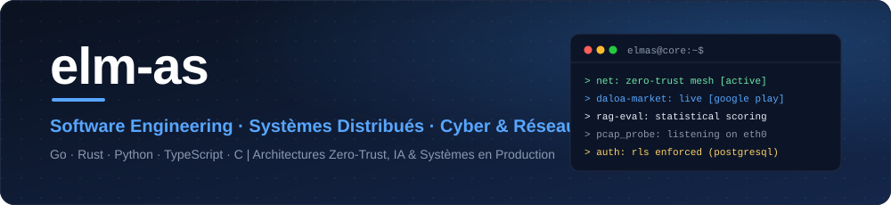
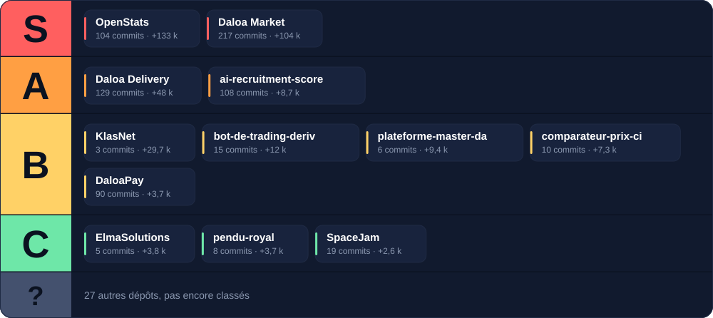
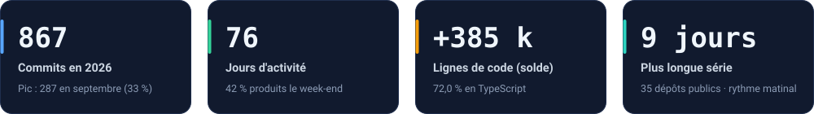
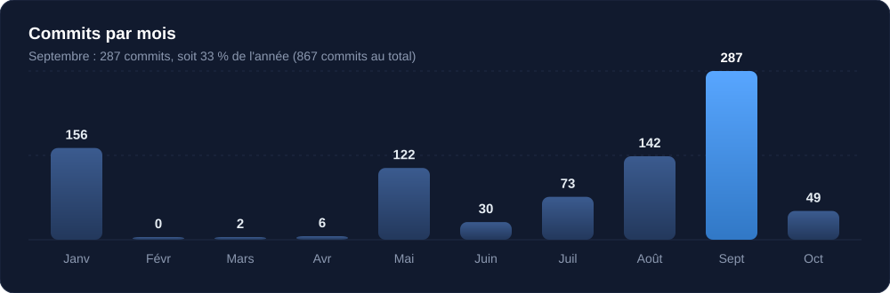
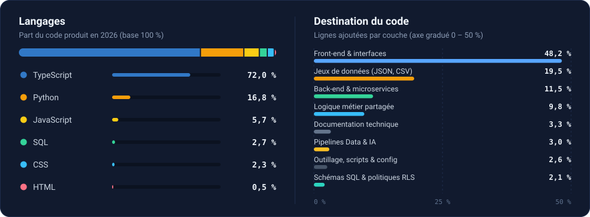

  

  

  
  
  

---

## 🎯 Profil & Démarche

Je m'appelle **Elmas**, basé à Abidjan. Ma démarche technique réunit la **rigueur mathématique** (Licence de Statistiques à l'UFHB, Master Data Science & IA à l'Université Rennes 2) et le **développement de systèmes déployés en conditions réelles**.

Concevoir un bon système repose sur trois principes stricts : **partir d'une donnée propre**, **verrouiller la sécurité au niveau de la base** et **écrire un code modulaire et testable qu'un tiers peut reprendre sans friction**.

### ✅ Ce que je livre aujourd'hui (En production & actif)

- **Applications Mobiles & Web** : Développement full-stack en **TypeScript** (**React**, **Vite**). Mon application [Daloa Market](https://github.com/elm-as/DaloaMarket-App) est déployée et disponible sur **Google Play**.
- **Architecture de Données & Sécurité** : Modélisation relationnelle sous **PostgreSQL** & **Supabase**, avec isolation des accès garantie par **Row-Level Security (RLS)** appliquée directement en base.
- **Data Science & Modélisation** : Traitement de données, analyses statistiques exploratoires et pipelines en **Python** (**Pandas**, **NumPy**, **Scikit-Learn**).
- **Discipline & Constance** : **867 commits** et **76 jours actifs** sur GitHub en 2026, avec plus de 380 000 lignes de code produites.

### 🔭 Ce que je construis ensuite (Systèmes, Cyber & Réseaux)

- **Programmation Système & Réseau** : Montée en compétences sur **Go** puis **Rust** pour concevoir des services réseau performants, concurrents et sobres en mémoire.
- **Sonde Réseau [NetSentinel](https://github.com/elm-as)** : Analyse passive de flux TCP/IP et détection d'anomalies (scans de ports, pics anormaux) couplée à un scoring statistique.
- **Reverse-Proxy Sécurisé (GateShield)** : Outil d'équilibrage et de limitation de débit (*rate-limiting*) pour appréhender en profondeur les attaques applicatives et la tenue en charge.
- **RAG Évalué Mathématiquement** : Système documentaire dont la fidélité et la pertinence sont quantifiées par métriques statistiques objectives avec pgvector.
- **Game Engine Mobile** : Exploration du moteur open-source **Godot** pour un prototype 2D/3D sur Android.

> 💼 Ouvert aux opportunités en **Data Science**, développement **Web / Mobile**, ainsi qu'aux environnements formateurs en **Systèmes, Réseaux et Cybersécurité**.

---

## 🌍 L'écosystème Daloa

Un ensemble cohérent de services pensés pour le commerce et la logistique locale, conçus de bout en bout :

  

---

## 🧭 Feuille de route des projets

Visualisation claire de ce qui est en production, en cours de finalisation, et en phase d'apprentissage / R&D :

  

---

## 🛠️ Projets phares

### 📱 Daloa Market · *Marketplace mobile en production sur Google Play*
> Plateforme unifiée connectant acheteurs et vendeurs locaux à Daloa. Catalogue temps réel, gestion des commandes, authentification et contrôle d'accès strict via PostgreSQL RLS.
>
> **Stack :** `TypeScript` · `React` · `Supabase` · `PostgreSQL`  
> **Dépôts :** [DaloaMarket-App](https://github.com/elm-as/DaloaMarket-App) · [DaloaMarket-v2](https://github.com/elm-as/DaloaMarket-v2)

### 🛵 Daloa Delivery · *Logistique du dernier kilomètre (en cours de finalisation)*
> Moteur d'attribution de courses aux livreurs et suivi temps réel des colis, interconnecté à Daloa Market.
>
> **Stack :** `TypeScript` · `React` · `Supabase` · `PostgreSQL`  
> **Dépôts :** [DaloaDelivery-App](https://github.com/elm-as/DaloaDelivery-App) · [DaloaDelivery](https://github.com/elm-as/DaloaDelivery)

### 📊 OpenStats · *Plateforme d'analyse statistique accessible*
> Le projet le plus volumineux de mon historique de code (+133 000 lignes) : démocratiser l'exploitation et la visualisation de séries statistiques sans obligation d'écrire du code.
>
> **Stack :** `TypeScript` · `Python`  
> **Dépôts :** [Stats](https://github.com/elm-as/Stats) · [openstat](https://github.com/elm-as/openstat)

### 🔬 Prochains chantiers (Systèmes & Cybersécurité)

*Ces projets constituent ma trajectoire d'apprentissage pratique vers les couches basses et l'infrastructure :*

| Projet | Objectif | Notions & Outils clés |
|---|---|---|
| 🛡️ **NetSentinel** | Sonde d'analyse passive de paquets et détection de comportements anormaux (scans, pics de syn) | `Go`, `Scapy`, `Wireshark`, protocoles TCP/IP |
| 📚 **RAG Évalué** | Moteur de recherche et synthèse documentaire avec métriques de confiance (fidélité, ancrage) | `Python`, `pgvector`, métriques statistiques |
| ⚡ **GateShield** | Reverse-proxy HTTP léger avec rate limiting dynamique et monitoring de trafic | `Go`, `Rust`, `Redis` |
| 🎮 **Prototype Jeu** | Jeu mobile expérimental pour explorer la boucle de rendu et la physique temps réel | `Godot` |

---

## 🏅 Répartition des projets (Tier List)

Classement basé sur le volume de code, le nombre de commits et l'impact opérationnel :

  

<b>🔍 Voir les chiffres détaillés par projet (12 projets principaux)</b>

 

| Projet | Dépôts associés | Commits | Solde de code | Statut |
|---|---|--:|--:|---|
| **OpenStats** | [OpenStats](https://github.com/elm-as/OpenStats), [Stats](https://github.com/elm-as/Stats) | 104 | +133 114 | Actif |
| **Daloa Market** | [DaloaMarket-v2](https://github.com/elm-as/DaloaMarket-v2), [DaloaMarket-App](https://github.com/elm-as/DaloaMarket-App) | 217 | +103 798 | **En production** (Google Play) |
| **Daloa Delivery** | [DaloaDelivery](https://github.com/elm-as/DaloaDelivery), [DaloaDelivery-App](https://github.com/elm-as/DaloaDelivery-App) | 129 | +48 339 | Finalisation |
| **ai-recruitment-score** | [ai-recruitment-score](https://github.com/elm-as/ai-recruitment-score) | 108 | +8 696 | Terminé |
| **KlasNet** | [KlasNet](https://github.com/elm-as/KlasNet) | 3 | +29 658 | Archive |
| **bot-de-trading-deriv** | [bot-de-trading-deriv](https://github.com/elm-as/bot-de-trading-deriv) | 15 | +11 972 | Terminé |
| **plateforme-master-da** | [plateforme-master-da](https://github.com/elm-as/plateforme-master-da) | 6 | +9 409 | Terminé |
| **comparateur-prix-ci** | [comparateur-prix-ci](https://github.com/elm-as/comparateur-prix-ci) | 10 | +7 256 | Prototype |
| **DaloaPay** | [DaloaPay](https://github.com/elm-as/DaloaPay) | 90 | +3 729 | En cours |
| **ElmaSolutions** | [ElmaSolutions](https://github.com/elm-as/ElmaSolutions) | 5 | +3 847 | Prototype |
| **pendu-royal** | [pendu-royal](https://github.com/elm-as/pendu-royal) | 8 | +3 674 | Terminé |
| **SpaceJam** | [SpaceJam](https://github.com/elm-as/SpaceJam) | 19 | +2 550 | Terminé |

---

## 🧰 Boîte à outils technique

### Technologies éprouvées en production

  

### Statistiques & Data Science

  
  
  

### Outils Systèmes & Réseaux en apprentissage actif

  
  

---

## 📊 Métriques & Activité 2026

  

  

  

  

---

## 🤝 Contact & Échanges

Je suis joignable pour discuter de projets concrets, de collaboration technique ou d'opportunités d'ingénierie :

- **LinkedIn** : [linkedin.com/in/elmas-dev](https://www.linkedin.com/in/elmas-dev)
- **E-mail** : [elmastresoroulobo@gmail.com](mailto:elmastresoroulobo@gmail.com)
- **Localisation** : Abidjan, Côte d'Ivoire (disponible en remote)

  

