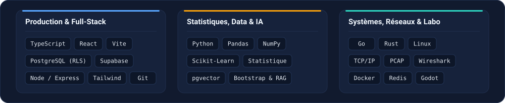

  

  &nbsp;
  &nbsp;
  &nbsp;
  

---

## 🎯 Profil & Principes d'ingénierie

Basé à Abidjan, je construis des produits logiciels à la croisée de la **modélisation statistique** (*Licence de Statistiques à l'UFHB*, *Master Data Science & IA à l'Université Rennes 2*) et de l'**ingénierie de systèmes déployés en conditions réelles**.

Chaque projet que je livre obéit à trois règles d'architecture non négociables :
1. **Partir d'une donnée propre** — diagnostic statistique, validation stricte des schémas et traçabilité dès l'entrée.
2. **Verrouiller la sécurité au plus près de la donnée** — isolation native des accès par **Row-Level Security (PostgreSQL RLS)** plutôt que par simples filtres applicatifs.
3. **Concevoir pour la reprise** — séparation nette entre interface, logique métier et accès aux données, sans couplage caché.

> 💼 **Ouvert aux opportunités** en **Data Science**, **Développement Full-Stack (Web / Mobile)** ainsi qu'aux environnements formateurs en **Systèmes, Réseaux & Cybersécurité** *(Abidjan ou remote)*.

---

## 🌍 Écosystème en production — La suite Daloa

Une infrastructure complète pensée pour digitaliser le commerce local, la logistique du dernier kilomètre et la sécurisation des transactions à Daloa :

  

- **Applications métiers** : [DaloaMarket-App](https://github.com/elm-as/DaloaMarket-App) *(en production sur [Google Play](https://play.google.com/store/apps/details?id=com.daloamarket.app))* · [DaloaMarket-v2](https://github.com/elm-as/DaloaMarket-v2) · [DaloaDelivery-App](https://github.com/elm-as/DaloaDelivery-App) · [DaloaDelivery](https://github.com/elm-as/DaloaDelivery) · [DaloaPay](https://github.com/elm-as/DaloaPay)
- **Socle backend & observabilité** : [api.daloamarket.ci](https://github.com/elm-as/api.daloamarket.ci) *(API paiements, séquestre & webhooks)* · [docs.daloamarket.ci](https://github.com/elm-as/docs.daloamarket.ci) *(portail VitePress)* · [status.daloamarket.ci](https://github.com/elm-as/status.daloamarket.ci) *(monitoring continu)*

---

## 🧭 Trajectoire technique & Chantiers R&D

Au-delà des applications web, mobiles et analytiques déjà livrées — notamment **OpenStats** ([Stats](https://github.com/elm-as/Stats) · [openstat](https://github.com/elm-as/openstat), **+133 000 lignes** dédiées au nettoyage automatisé et à l'analyse statistique sans code) — ma progression actuelle descend méthodiquement vers les couches systèmes et réseaux :

  

| Chantier | Objectif d'ingénierie | Socle technique |
|---|---|---|
| 🛡️ **[NetSentinel](https://github.com/elm-as/NetSentinel)** | Sonde d'analyse passive de flux TCP/IP et détection statistique d'anomalies (Welford & Z-Score anti-empoisonnement) | `Go` · `PCAP` · `TCP/IP` · `Statistiques` |
| ⚡ **[GateShield](https://github.com/elm-as/GateShield)** | Reverse-proxy HTTP défensif avec *rate-limiting* Token Bucket, garde-fous anti-Slowloris et télémétrie atomique | `Go` · `HTTP Proxy` · `Token Bucket` |
| 📚 **[StatRAG](https://github.com/elm-as/StatRAG)** | Recherche documentaire (`PostgreSQL + pgvector` sous RLS) quantifiée par fidélité et intervalles de confiance bootstrap | `Python` · `pgvector` · `Bootstrap 95 %` |
| 🎮 **Prototype Mobile** | Expérimentation autour de la boucle de rendu et de la physique temps réel sur Android | `Godot Engine` |

---

## 🗂️ Cartographie des réalisations

Vue consolidée de mes projets par maturité opérationnelle, volume de code et domaine :

  

<b>🔍 Consulter le registre détaillé des projets (commits, volume et accès aux dépôts)</b>

 

| Projet | Accès / Dépôts | Commits | Solde de code | Statut |
|---|---|--:|--:|---|
| **Daloa Market** | [DaloaMarket-App](https://github.com/elm-as/DaloaMarket-App) · [DaloaMarket-v2](https://github.com/elm-as/DaloaMarket-v2) | 217 | +103 798 | **En production** ([Google Play](https://play.google.com/store/apps/details?id=com.daloamarket.app)) |
| **OpenStats** | [Stats](https://github.com/elm-as/Stats) · [openstat](https://github.com/elm-as/openstat) | 104 | +133 114 | Actif |
| **Daloa Delivery** | [DaloaDelivery-App](https://github.com/elm-as/DaloaDelivery-App) · [DaloaDelivery](https://github.com/elm-as/DaloaDelivery) | 129 | +48 339 | Finalisation |
| **Daloa Pay & API** | [DaloaPay](https://github.com/elm-as/DaloaPay) · [api.daloamarket.ci](https://github.com/elm-as/api.daloamarket.ci) | 90+ | +3 729 | Développement actif |
| **ai-recruitment-score** | `Dépôt privé` · proto public : [neural-recruit](https://github.com/elm-as/neural-recruit) | 108 | +8 696 | Terminé |
| **KlasNet** | [KlasNet](https://github.com/elm-as/KlasNet) | 3 | +29 658 | Archive |
| **bot-de-trading-deriv** | `Dépôt privé` | 15 | +11 972 | Terminé |
| **plateforme-master-da** | `Dépôt privé` | 6 | +9 409 | Terminé |
| **comparateur-prix-ci** | `Dépôt privé` | 10 | +7 256 | Prototype |
| **ElmaSolutions** | `Dépôt privé` | 5 | +3 847 | Prototype |
| **pendu-royal** | [pendu-royal](https://github.com/elm-as/pendu-royal) | 8 | +3 674 | Terminé *(Android/Kivy)* |
| **SpaceJam** | [SpaceJam](https://github.com/elm-as/SpaceJam) | 19 | +2 550 | Terminé |
| **Systèmes & RAG (R&D)** | [NetSentinel](https://github.com/elm-as/NetSentinel) · [GateShield](https://github.com/elm-as/GateShield) · [StatRAG](https://github.com/elm-as/StatRAG) | 3+ | +2 300 | **Socle v0.1 actif** |
| **Prototypes Sécu & Data** | [kripton](https://github.com/elm-as/kripton) · [vanguard-sec](https://github.com/elm-as/vanguard-sec) · [datasci-os](https://github.com/elm-as/datasci-os) · [med-connect](https://github.com/elm-as/med-connect) | — | — | Laboratoire public |

---

## 🧰 Boîte à outils technique

Compétences organisées honnêtement selon leur niveau d'usage réel — de la production quotidienne aux chantiers bas niveau en cours :

  

---

## 📊 Télémétrie & Activité 2026

  

  

  

  

---

## 🤝 Contact & Échanges

Disponible pour échanger autour de projets d'ingénierie exigeants, d'architectures orientées données ou d'opportunités d'équipe :

- **LinkedIn** : [linkedin.com/in/elmas-dev](https://www.linkedin.com/in/elmas-dev)
- **E-mail** : [elmastresoroulobo@gmail.com](mailto:elmastresoroulobo@gmail.com)
- **Localisation** : Abidjan, Côte d'Ivoire *(disponible en remote)*

  

